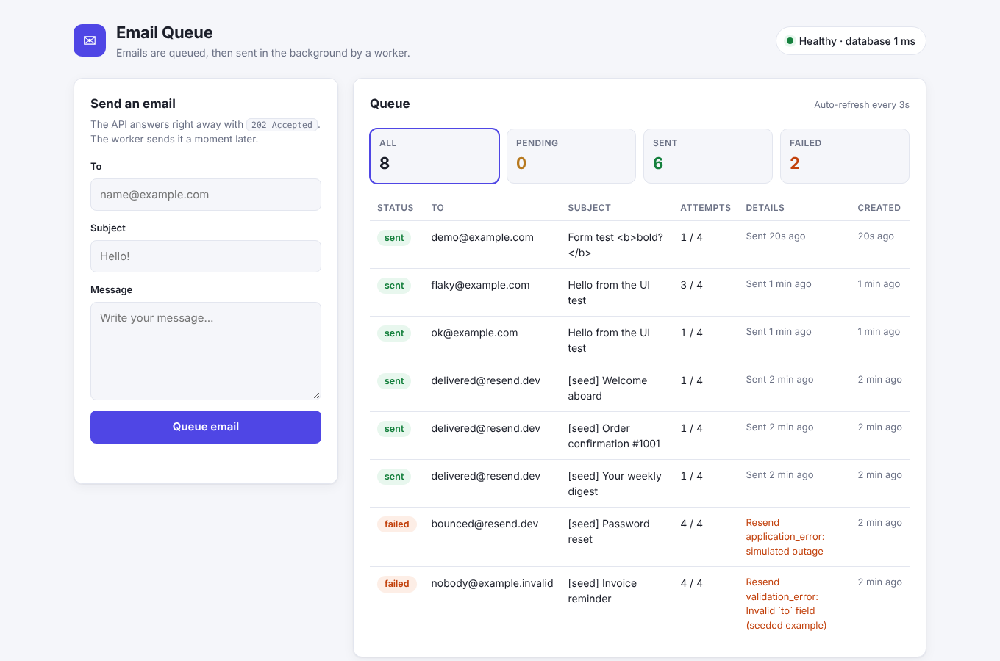
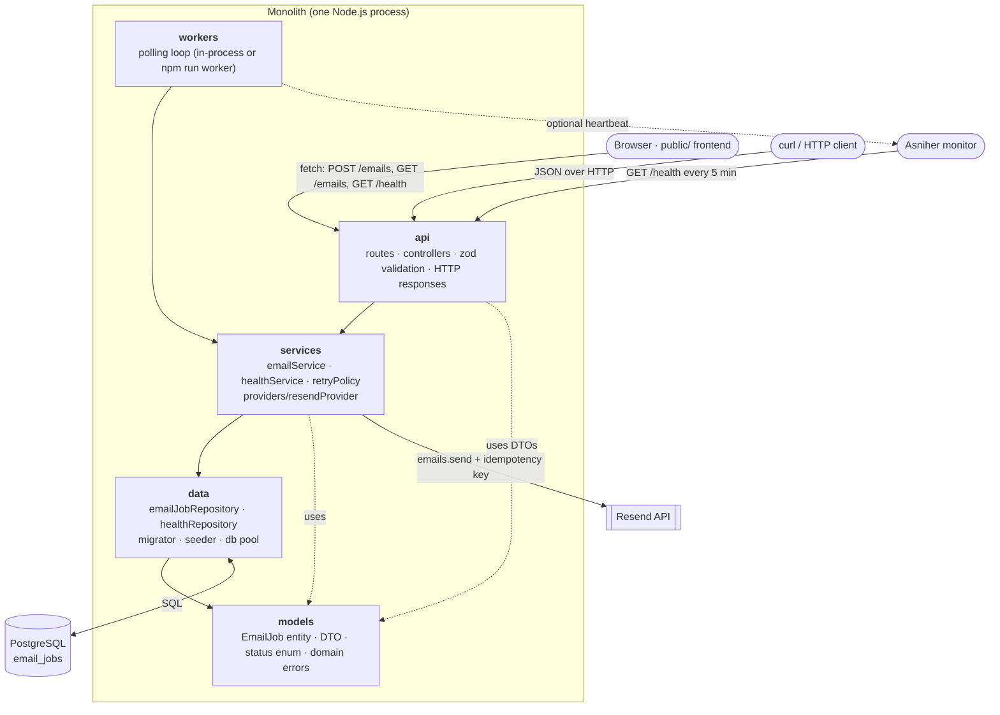
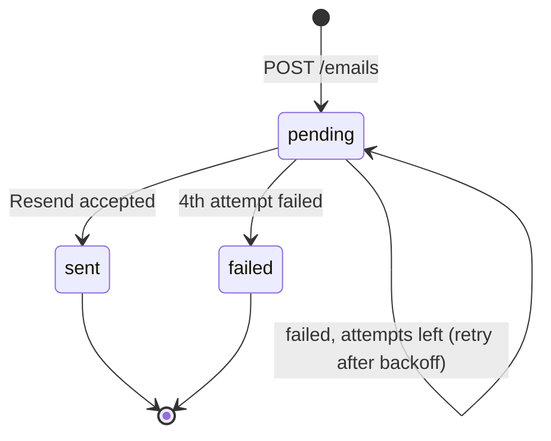
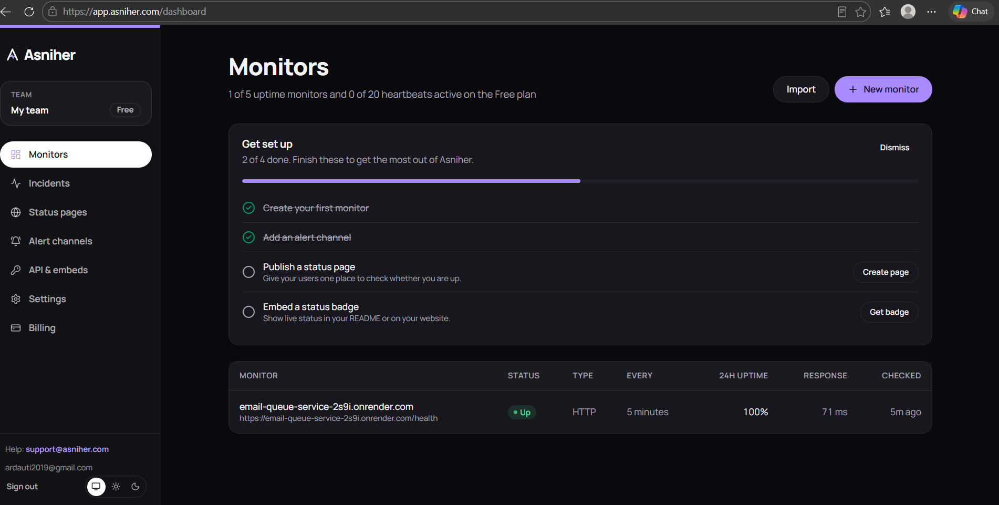

# Email Queue Service

A small monolithic app (Node.js · Express 5 · PostgreSQL) with a one-page frontend that **queues emails and sends them in the background through [Resend](https://resend.com/docs)**, with automatic retries, a `/health` endpoint, and production monitoring on [Asniher](https://asniher.com/).



- API endpoints never send email directly — they insert a job and return `202 Accepted`.
- A background worker claims due jobs, sends them via Resend, and records the outcome.
- Every job has a status in the database: `pending` → `sent` or `failed`.
- Failed sends are retried **3 times** (4 attempts in total) with exponential backoff.
- The frontend (served by the same app at `/`) lets you send an email and watch it move from `pending` to `sent` or `failed`.

**Live URL:** `https://<your-app>.onrender.com` · **Monitor:** see [Monitoring](#monitoring)

---

## Contents

1. [Architecture](#architecture)
2. [Frontend](#frontend)
3. [Setup](#setup)
4. [Environment variables](#environment-variables)
5. [API and example requests](#api-and-example-requests)
6. [How the queue works](#how-the-queue-works)
7. [Deployment](#deployment)
8. [Monitoring](#monitoring)
9. [Project structure](#project-structure)

---

## Architecture

The code is split into four layers. **Each layer may only call the layer directly below it.**



| Layer | Folder | Responsibility | Never contains |
|---|---|---|---|
| **api** | `src/api` | Routes, controllers, request validation (zod), mapping errors to status codes, HTTP responses | SQL, business rules |
| **services** | `src/services` | Business logic: enqueueing, retry/backoff decisions, sending through the Resend provider, health logic | SQL, `req`/`res`, status codes |
| **data** | `src/data` | Repositories and **all** database access (queries, migrations runner, seeder, connection pool) | HTTP, business decisions |
| **models** | `src/models` | `EmailJob` entity mapping, DTOs, status enum, domain errors | Any I/O |

Entry points (`src/server.js`, `src/worker.js`) and the worker loop (`src/workers`) sit on top and only call services.

The rules are checked automatically:

```bash
npm run check:layers
# Layer rules OK: api -> services -> data -> models, SQL only in data, HTTP only in api.
```

Services throw **domain errors** (`NotFoundError`, `DomainValidationError`); only the api layer's error handler turns them into `404` / `400`. That is how HTTP concerns stay out of the services.

---

## Frontend

The app serves a single page from `public/` at **`/`** (no build step, no framework). It only talks to the API, the same way `curl` would:

| Part of the page | Endpoint |
|---|---|
| **Send an email** form | `POST /emails` → shows validation errors from the API next to the fields |
| **Queue** table (auto-refreshes every 3 s, filter by status) | `GET /emails?status=…` |
| Health pill and the pending / sent / failed counters | `GET /health` |

Each row shows the status, the attempts (`3 / 4`), the last error, and when the next retry happens, so retries can be watched live. All text from the API is inserted with `textContent`, so user input can't inject HTML.

---

## Setup

### Requirements

- Node.js 20+
- PostgreSQL 13+ (uses the built-in `gen_random_uuid()`)
- A Resend account and API key

### Option A — local Node + your own PostgreSQL

```bash
git clone https://github.com/<your-username>/email-queue-service.git
cd email-queue-service
npm install

cp .env.example .env            # then fill in RESEND_API_KEY and DB settings
createdb email_queue            # or create it in pgAdmin

npm run migrate                 # create tables + indexes
npm run seed                    # optional: demo jobs (sent to Resend test inboxes)
npm start                       # app on http://localhost:3000 (frontend + API) + background worker
```

### Option B — Docker Compose (PostgreSQL included)

```bash
cp .env.example .env            # add RESEND_API_KEY
docker compose up --build       # migrations run automatically on start
docker compose exec app npm run seed
```

### Scripts

| Command | What it does |
|---|---|
| `npm start` | Start the API (and the worker, if `RUN_WORKER_IN_PROCESS=true`) |
| `npm run dev` | Same, with auto-restart on file changes |
| `npm run worker` | Run the worker as a separate process |
| `npm run migrate` | Apply pending SQL migrations from `migrations/` (tracked in `schema_migrations`) |
| `npm run seed` | Insert demo jobs (re-runnable; replaces previous demo rows). `npm run seed -- --reset` clears all jobs first |
| `npm test` | Unit tests (service logic and retry policy, no DB needed) |
| `npm run check:layers` | Verify the layering rules |

> **Sending to real inboxes:** with `EMAIL_FROM=…@resend.dev` Resend only delivers to the email address of your own Resend account. To send to anyone, verify a domain in Resend and use an address on it. The seed data uses Resend's test inboxes (`delivered@resend.dev`, `bounced@resend.dev`), so it is always safe to run.

---

## Environment variables

All configuration comes from the environment (`src/config.js`). Copy `.env.example` to `.env` for local development. **`.env` is git-ignored; never commit real keys.**

| Variable | Default | Description |
|---|---|---|
| `PORT` | `3000` | HTTP port |
| `NODE_ENV` | `development` | Environment name |
| `DATABASE_URL` | — | Full PostgreSQL URL. Takes priority over the `PG*` variables |
| `PGHOST` / `PGPORT` | `localhost` / `5432` | Database host and port |
| `PGUSER` / `PGPASSWORD` | `postgres` / `postgres` | Database credentials |
| `PGDATABASE` | `email_queue` | Database name |
| `PGSSL` | `false` | `true` for managed databases that require TLS |
| `PG_CONNECT_TIMEOUT_MS` | `3000` | Connection timeout; keeps `/health` fast when the DB is down |
| `RESEND_API_KEY` | — | **Required** to send. Without it every attempt fails (and is retried) |
| `EMAIL_FROM` | `Email Queue <onboarding@resend.dev>` | Sender address (verified domain in Resend) |
| `RUN_WORKER_IN_PROCESS` | `true` | Run the worker inside the web process |
| `WORKER_POLL_INTERVAL_MS` | `2000` | How often the worker checks for due jobs |
| `WORKER_BATCH_SIZE` | `10` | Max jobs claimed per poll |
| `WORKER_LOCK_TIMEOUT_MS` | `60000` | Lease on a claimed job; if a worker crashes, the job is picked up again after this |
| `EMAIL_MAX_RETRIES` | `3` | Retries after the first attempt |
| `EMAIL_RETRY_BASE_DELAY_MS` | `5000` | Backoff base: 5 s, 10 s, 20 s… |
| `WORKER_HEARTBEAT_URL` | — | Optional Asniher heartbeat URL, pinged at most once a minute while the worker is healthy |

---

## API and example requests

Base URL locally: `http://localhost:3000`

| Method | Path | Description | Success |
|---|---|---|---|
| `GET` | `/health` | App + database status | `200` / `503` |
| `POST` | `/emails` | Queue an email | `202` |
| `GET` | `/emails/:id` | Get one job and its status | `200` |
| `GET` | `/emails?status=&limit=&offset=` | List jobs (newest first) | `200` |

### Queue an email

```bash
curl -i -X POST http://localhost:3000/emails \
  -H "Content-Type: application/json" \
  -d '{
        "to": "delivered@resend.dev",
        "subject": "Welcome!",
        "html": "<h1>Hello</h1><p>Thanks for signing up.</p>",
        "text": "Hello! Thanks for signing up."
      }'
```

```http
HTTP/1.1 202 Accepted
Location: /emails/cc9a577b-5118-46fe-a15d-6783f5543c21
```

```json
{
  "message": "Email queued",
  "job": {
    "id": "cc9a577b-5118-46fe-a15d-6783f5543c21",
    "to": "delivered@resend.dev",
    "subject": "Welcome!",
    "status": "pending",
    "attempts": 0,
    "maxAttempts": 4,
    "lastError": null,
    "providerMessageId": null,
    "nextAttemptAt": "2026-11-02T22:20:02.234Z",
    "sentAt": null,
    "createdAt": "2026-11-02T22:20:02.234Z",
    "updatedAt": "2026-11-02T22:20:02.234Z"
  }
}
```

Body rules: `to` must be an email, `subject` is required, and at least one of `html` / `text` must be present. Unknown fields are rejected.

### Check the job

```bash
curl http://localhost:3000/emails/cc9a577b-5118-46fe-a15d-6783f5543c21
```

```json
{ "job": { "id": "cc9a577b-…", "status": "sent", "attempts": 1, "providerMessageId": "4ef9a417-…", "sentAt": "2026-11-02T22:20:03.101Z", "…": "…" } }
```

### List jobs

```bash
curl "http://localhost:3000/emails?status=failed&limit=10"
```

### Validation error (400)

```bash
curl -X POST http://localhost:3000/emails -H "Content-Type: application/json" \
  -d '{"to":"not-an-email","subject":""}'
```

```json
{
  "error": "ValidationError",
  "message": "Request validation failed",
  "details": [
    { "field": "to", "message": "to must be a valid email address" },
    { "field": "subject", "message": "subject is required" },
    { "field": "html", "message": "Provide html or text" }
  ]
}
```

Other errors: malformed JSON → `400 BadRequest`, non-UUID id → `400`, unknown job → `404 NotFound`.

### Healthcheck

```bash
curl -i http://localhost:3000/health
```

Healthy — **200**:

```json
{
  "status": "ok",
  "timestamp": "2026-11-02T22:20:02.150Z",
  "app": { "status": "up", "name": "email-queue-service", "version": "1.0.0", "uptimeSeconds": 1 },
  "database": { "status": "up", "latencyMs": 5 },
  "worker": { "running": true, "lastRunAt": "2026-11-02T22:20:01.839Z", "lastProcessed": 0, "lastError": null },
  "queue": { "pending": 1, "sent": 3, "failed": 1 }
}
```

Database unreachable — **503**:

```json
{
  "status": "error",
  "timestamp": "2026-11-02T22:20:16.829Z",
  "app": { "status": "up", "name": "email-queue-service", "version": "1.0.0", "uptimeSeconds": 16 },
  "database": { "status": "down", "error": "connect ECONNREFUSED 127.0.0.1:5433" },
  "worker": { "running": true, "lastRunAt": "2026-11-02T22:20:16.712Z", "lastProcessed": 0, "lastError": null }
}
```

The app keeps running while the database is down and returns to `200` by itself once it comes back.

---

## How the queue works

The queue is the `email_jobs` table itself (no Redis needed), using PostgreSQL row locking.



1. **Enqueue** — `POST /emails` validates the body and inserts a row with `status = 'pending'`, `attempts = 0`, `max_attempts = 4`. Response: `202`.
2. **Claim** — every `WORKER_POLL_INTERVAL_MS` the worker runs one atomic `UPDATE … WHERE id IN (SELECT … FOR UPDATE SKIP LOCKED)` that takes due pending jobs and sets a short lease (`locked_until`). Several workers can run at once without picking the same job, and a job held by a crashed worker becomes available again when the lease ends.
3. **Send** — the service calls Resend with the job id as the **idempotency key**, so a retry after a timeout cannot deliver the same email twice.
4. **Record**
   - success → `status = 'sent'`, `provider_message_id`, `sent_at`
   - failure with attempts left → stays `pending`, `attempts + 1`, `last_error`, `next_attempt_at = now + 5s · 2^(n-1)` (5 s, 10 s, 20 s)
   - 4th failure → `status = 'failed'` with the last error kept for debugging

Verified locally against PostgreSQL 16 with a simulated Resend API: an email that failed twice was sent on attempt 3, and an always-failing one ended as `failed` after exactly 4 attempts.

### Database schema

`migrations/001_create_email_jobs.sql`, `migrations/002_add_email_jobs_indexes.sql`

| Column | Type | Notes |
|---|---|---|
| `id` | `UUID` PK | `gen_random_uuid()` |
| `to_address`, `subject` | `VARCHAR` | |
| `html`, `text` | `TEXT` | at least one required (CHECK) |
| `status` | `VARCHAR(16)` | CHECK in (`pending`, `sent`, `failed`) |
| `attempts`, `max_attempts` | `INTEGER` | |
| `last_error`, `provider_message_id` | | |
| `next_attempt_at`, `locked_until`, `sent_at` | `TIMESTAMPTZ` | scheduling, lease, delivery time |
| `created_at`, `updated_at` | `TIMESTAMPTZ` | |

Indexes: a partial index on `next_attempt_at WHERE status = 'pending'` for the worker, and `(status, created_at DESC)` for listing.

---

## Deployment

### Render (free tier, using `render.yaml`)

1. Push this repo to GitHub.
2. In Render: **New → Blueprint**, choose the repo. It creates the web service and a PostgreSQL database and wires `DATABASE_URL` automatically.
3. In the web service's **Environment** tab set `RESEND_API_KEY` and `EMAIL_FROM`.
4. Deploy. The start command runs `npm run migrate` and then `npm start`.
5. Open `https://<your-app>.onrender.com/health` — it should return `200`.

Notes: free Render web services sleep after ~15 minutes without traffic; the Asniher check every 5 minutes keeps it awake. Render's free PostgreSQL expires after a trial period — for a longer-lived free database use [Neon](https://neon.tech) and set `DATABASE_URL` plus `PGSSL=true`.

### Anywhere with Docker

```bash
docker build -t email-queue-service .
docker run -p 3000:3000 --env-file .env email-queue-service
```

---

## Monitoring

The `/health` endpoint is monitored with **Asniher**:

1. Create a free account at [asniher.com](https://asniher.com/).
2. Add an **HTTP(S) monitor**: URL `https://<your-app>.onrender.com/health`, method `GET`, expected status `200`, interval 5 minutes (free plan). Optionally add a keyword check for `"status":"ok"`.
3. Add an alert channel (email, Slack or Discord).
4. *(Optional)* Add a **Heartbeat monitor** for the queue worker, copy its ping URL into `WORKER_HEARTBEAT_URL`, and redeploy. If the worker loop stops, Asniher alerts you even while the API still answers.

Because `/health` returns `503` when PostgreSQL is unreachable, the monitor marks the service **down** on database outages, not only when the process crashes.

### Monitor screenshot



---

## Project structure

```
.
├── migrations/                 # SQL migrations, applied in filename order
│   ├── 001_create_email_jobs.sql
│   └── 002_add_email_jobs_indexes.sql
├── public/                     # frontend: index.html, styles.css, app.js (served at /)
├── scripts/
│   ├── migrate.js              # CLI → data/migrator
│   ├── seed.js                 # CLI → data/seeder
│   └── check-layers.js         # enforces the layering rules
├── src/
│   ├── api/                    # LAYER 1: HTTP only
│   │   ├── app.js
│   │   ├── routes.js
│   │   ├── controllers/        # emailController, healthController
│   │   ├── middleware/         # validate, errorHandler
│   │   └── validation/         # zod schemas
│   ├── services/               # LAYER 2: business logic
│   │   ├── emailService.js
│   │   ├── healthService.js
│   │   ├── retryPolicy.js
│   │   └── providers/resendProvider.js
│   ├── data/                   # LAYER 3: all database access
│   │   ├── db.js
│   │   ├── emailJobRepository.js
│   │   ├── healthRepository.js
│   │   ├── migrator.js
│   │   └── seeder.js
│   ├── models/                 # LAYER 4: entities, DTOs, enums, errors
│   │   ├── emailJob.js
│   │   └── errors.js
│   ├── workers/emailWorker.js  # background polling loop (calls services)
│   ├── config.js               # env → config
│   ├── server.js               # entry: API + in-process worker
│   └── worker.js               # entry: standalone worker
├── docs/                       # screenshots (frontend, Asniher monitor)
├── test/emailService.test.js
├── .env.example
├── Dockerfile
├── docker-compose.yml
└── render.yaml
```

## License

MIT
